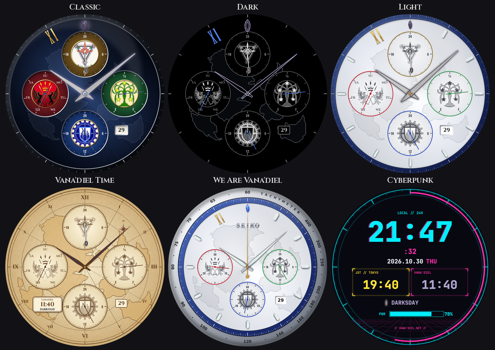
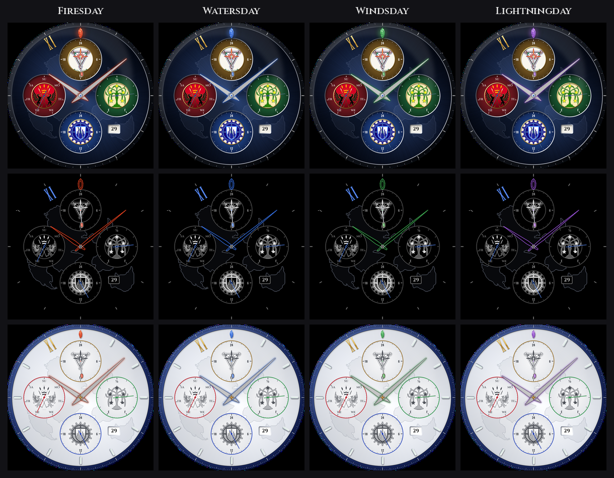

# Vana'diel Chronograph: FFXI watch face for Wear OS

A Pixel Watch / Wear OS watch face inspired by the Seiko × FINAL FANTASY XI
"WE ARE VANA'DIEL" 20th-anniversary chronograph. It's built with Google's
**Watch Face Format** (WFF), so it's an XML-and-images package with no app code.



Switch styles on the watch: long-press the face, tap **Customize**, then **Style**: Classic, Dark, Light,
Vana'diel Time, We Are Vana'diel or Cyberpunk.
Light follows the real Seiko piece: silver-white dial, blue inner ring, lume batons, white sub-dials with
nation-coloured rings and hands. Every style uses the real watch's sub-dial order: San d'Oria at 9
(day of week), Bastok at 6 (24-hour), Windurst at 3 (battery).

Classic, Dark and Light also have a fourth dial at 12 under the Jeuno crest: **Vana'diel time** on a
24-hour scale (one turn per Vana'diel day, 57.6 Earth minutes). Its hand is tipped with today's
elemental crystal, so its colour tells you the Vana'diel weekday (Firesday red, Earthsday ochre,
Watersday blue, Windsday green, Iceday pale blue, Lightningday violet, Lightsday white, Darksday black):


The weekday colours the whole face too: the 12 o'clock crystal turns the element's colour (a glowing
coloured crystal on Classic and Light, coloured line art on Dark) and the main hands pick it up as a
coloured edge and glow (Classic, Light) or coloured outlines (Dark):



**Vana'diel Time** is a parchment map of Vana'diel with the same four dials in a tan, inked look, Earth time
on ink hands inlaid with the weekday colour, and a cartouche with Vana'diel time (25x Earth time) and the
elemental weekday.

**We Are Vana'diel** is a replica of the real Seiko piece (for personal use): tachymeter bezel, blue inner
ring, SEIKO, crystal-shaped lume markers, and the watch's own sub-dials (San d'Oria 30-minute counter at 9,
Windurst 24-hour at 3, Bastok running seconds at 6), with the gold chronograph hand resting at 12.

**Cyberpunk** is a high-visibility digital face: large local time with seconds and date, JST (Tokyo) time,
Vana'diel time in the weekday colour, the elemental weekday, a battery bar and a seconds arc around the rim.

The live Vana'diel and JST maths is in `tools/wff_expr.py`. Both are computed on the
watch from the UTC time: one Earth day is exactly 25 Vana'diel days, so the time of day depends only on
the UTC time of day, and the weekday counts days since 2002-06-23 15:00 UTC.

All three styles carry a faint outline of Vana'diel behind the dial (not in always-on). The land shapes are
cut from `tools/emblems/worldmap_source.png` into `tools/emblems/worldmap_land.png`.
Dark is the minimalist outline look: thin outline hands, hairline sub-dial needles, a white line-drawn crystal
at 12, a crystal-blue XI, no other hour markers, and all three crests in one style (grey silhouettes with a
light edge, details picked out in white).

## Design (after the Seiko piece)

| Seiko element | This face |
|---|---|
| Blue crystal index at 12 | Large faceted blue crystal with glow |
| "XI" at 11 | Gold serif **XI** |
| Crystal-shaped indices | Faceted silver crystals at 1, 2, 4, 5, 7, 8, 10 |
| Three sub-dials styled on the three nations' banners (crest medallion in the centre) | **San d'Oria** (red, 9 o'clock): day of week<br>**Bastok** (blue, 3 o'clock): battery E→F<br>**Windurst** (green, 6 o'clock): 24-hour hand |
| Date window | Live date at 4:30 |

There's no seconds hand, by choice. Always-on mode uses a dimmed version of the Dark style.

## Install from your phone (no computer)

Every push to `ffxi-watchface/` is built by GitHub Actions
(`.github/workflows/build-watchface.yml`). The APK is published here:
https://github.com/IRey72/SLM-Lab/releases/download/watchface-latest/vanadiel-chronograph.apk

1. On the watch: Settings → System → About → Versions, tap **Build number** 7 times.
   Then Settings → Developer options: turn on **ADB debugging** and **Wireless debugging**.
2. On your Android phone, install an ADB-over-Wi-Fi app such as **Bugjaeger** (or Wear Installer 2).
   The phone and watch must be on the same Wi-Fi.
3. On the watch, open Wireless debugging → **Pair new device**. Enter the IP, port and code it
   shows into the app's pairing screen, then connect using the port shown under *IP address & port*.
4. Download the APK above on your phone, then use the app's install-APK action to push it to the watch.
5. Long-press the watch face → **+ Add** → **Vana'diel Chronograph**.

## Build & install from a computer

You need Android Studio (or the Android SDK plus Gradle 8.7 or newer).

1. Open this `ffxi-watchface/` folder in Android Studio. It will offer to set up the Gradle wrapper.
2. Turn on **Developer options → ADB debugging + Debug over Wi-Fi** on the watch, then pair it:
   `adb pair <ip>:<pair-port>` then `adb connect <ip>:<port>`.
3. Build and install:
   ```
   ./gradlew :app:assembleDebug
   adb install app/build/outputs/apk/debug/app-debug.apk
   ```
4. On the watch, long-press the current face, swipe to the end, tap **+ Add**, and pick
   **Vana'diel Chronograph**. The Pixel Watch app on your phone also lists it.

## Tweaking the look

All art comes from `tools/generate_assets.py` (Pillow, numpy and fontTools).
The nation crests are square crops in `tools/emblems/`. Replace a crop to change a crest.
The hands are cut from the photo in `tools/hands/source_photo.png` by `tools/extract_hands.py`
(needs scipy). The cut-outs are committed, so you only need to re-run it with a new photo. Edit the colours and
layout constants at the top, then run:

```
python3 tools/generate_assets.py
```

This rewrites the PNGs in `app/src/main/res/drawable-nodpi/` and the previews in `docs/`.
If you move a sub-dial, the date window or a hand size, update the matching
coordinates in `app/src/main/res/raw/watchface.xml`.

Fonts: "Final Fantasy" by Juan Pablo Reyes Altamirano (XI), plus Cinzel, Oswald and JetBrains Mono
(SIL Open Font License). See `tools/fonts/`.

Fan-made and unofficial. Not affiliated with Seiko or Square Enix.
