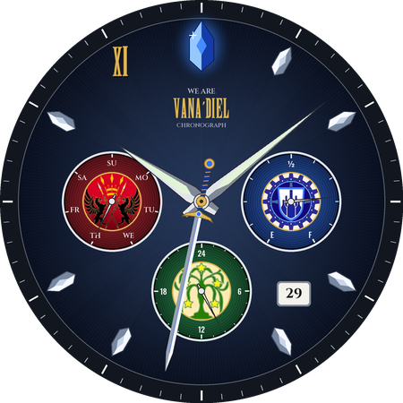
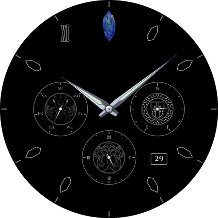
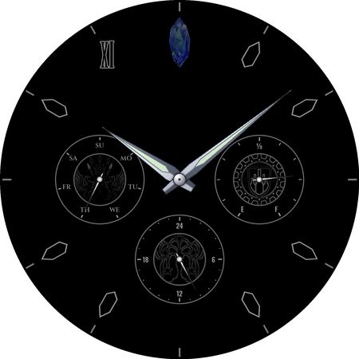

# Vana'diel Chronograph: FFXI watch face for Wear OS

A Pixel Watch / Wear OS watch face inspired by the Seiko × FINAL FANTASY XI
"WE ARE VANA'DIEL" 20th-anniversary chronograph. It's built with Google's
**Watch Face Format** (WFF), so it's an XML-and-images package with no app code.

| Classic | Dark | Always-on |
|---|---|---|
|  |  |  |

Switch styles on the watch: long-press the face, tap **Customize**, then **Style** (Classic or Dark).
Dark is the minimalist outline look, with the crests drawn as line art.

## Design (after the Seiko piece)

| Seiko element | This face |
|---|---|
| Blue crystal index at 12 | Large faceted blue crystal with glow |
| "XI" at 11 | Gold serif **XI** |
| Crystal-shaped indices | Faceted silver crystals at 1, 2, 4, 5, 7, 8, 10 |
| Three sub-dials styled on the three nations' banners (crest medallion in the centre) | **San d'Oria** (red, 9 o'clock): day of week<br>**Bastok** (blue, 3 o'clock): battery E→F<br>**Windurst** (green, 6 o'clock): 24-hour hand |
| Date window | Live date at 4:30 |

There's no seconds hand, by choice. Always-on mode uses a dimmed version of the Dark style.

## Install from your phone (no computer)

Every push to `ffxi-watchface/` is built by GitHub Actions
(`.github/workflows/build-watchface.yml`). The APK is published here:
https://github.com/IRey72/SLM-Lab/releases/download/watchface-latest/vanadiel-chronograph.apk

1. On the watch: Settings → System → About → Versions, tap **Build number** 7 times.
   Then Settings → Developer options: turn on **ADB debugging** and **Wireless debugging**.
2. On your Android phone, install an ADB-over-Wi-Fi app such as **Bugjaeger** (or Wear Installer 2).
   The phone and watch must be on the same Wi-Fi.
3. On the watch, open Wireless debugging → **Pair new device**. Enter the IP, port and code it
   shows into the app's pairing screen, then connect using the port shown under *IP address & port*.
4. Download the APK above on your phone, then use the app's install-APK action to push it to the watch.
5. Long-press the watch face → **+ Add** → **Vana'diel Chronograph**.

## Build & install from a computer

You need Android Studio (or the Android SDK plus Gradle 8.7 or newer).

1. Open this `ffxi-watchface/` folder in Android Studio. It will offer to set up the Gradle wrapper.
2. Turn on **Developer options → ADB debugging + Debug over Wi-Fi** on the watch, then pair it:
   `adb pair <ip>:<pair-port>` then `adb connect <ip>:<port>`.
3. Build and install:
   ```
   ./gradlew :app:assembleDebug
   adb install app/build/outputs/apk/debug/app-debug.apk
   ```
4. On the watch, long-press the current face, swipe to the end, tap **+ Add**, and pick
   **Vana'diel Chronograph**. The Pixel Watch app on your phone also lists it.

## Tweaking the look

All art comes from `tools/generate_assets.py` (Pillow, numpy and fontTools).
The nation crests are square crops in `tools/emblems/`. Replace a crop to change a crest. Edit the colours and
layout constants at the top, then run:

```
python3 tools/generate_assets.py
```

This rewrites the PNGs in `app/src/main/res/drawable-nodpi/` and the previews in `docs/`.
If you move a sub-dial, the date window or a hand size, update the matching
coordinates in `app/src/main/res/raw/watchface.xml`.

Fonts: "Final Fantasy" by Juan Pablo Reyes Altamirano (XI and the VANA'DIEL wordmark),
plus Cinzel and Oswald (SIL Open Font License). See `tools/fonts/`.

Fan-made and unofficial. Not affiliated with Seiko or Square Enix.
